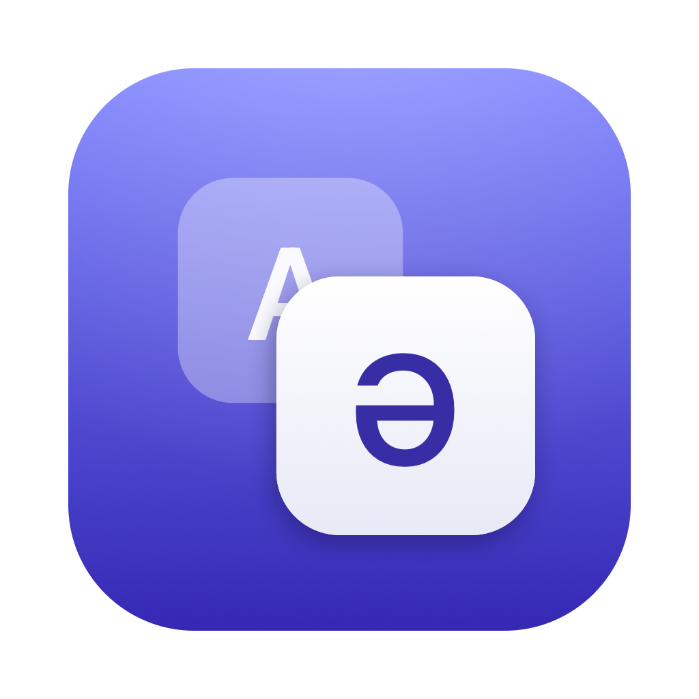
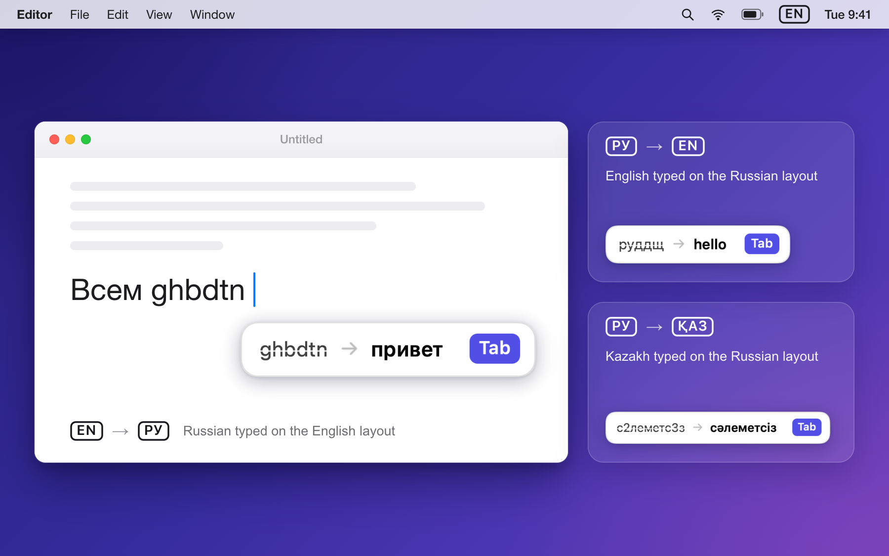
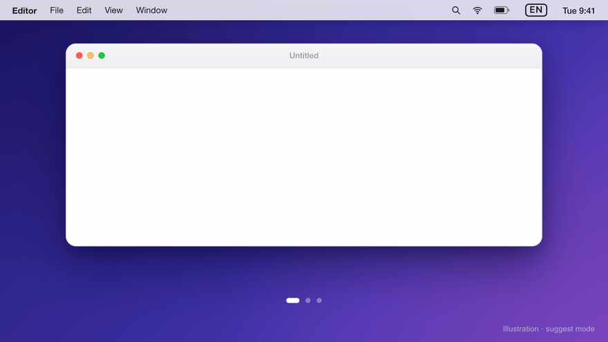
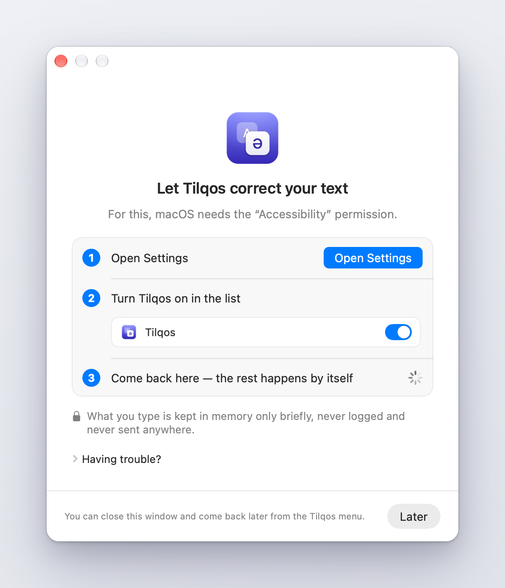
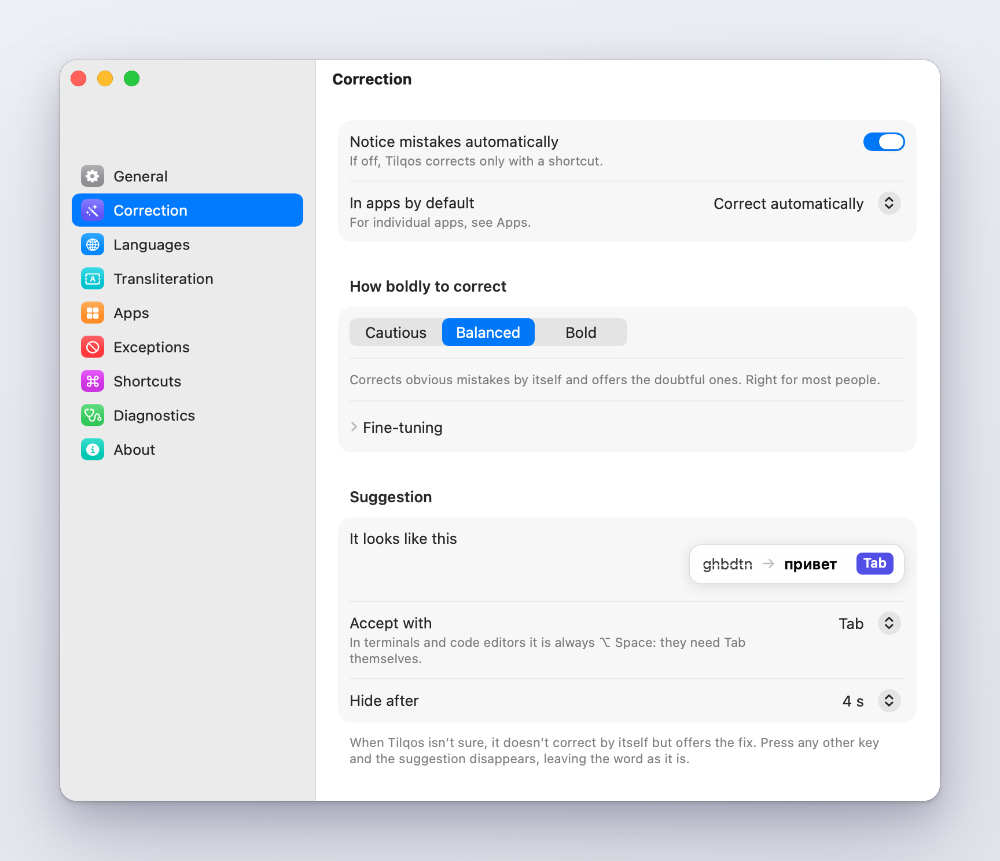
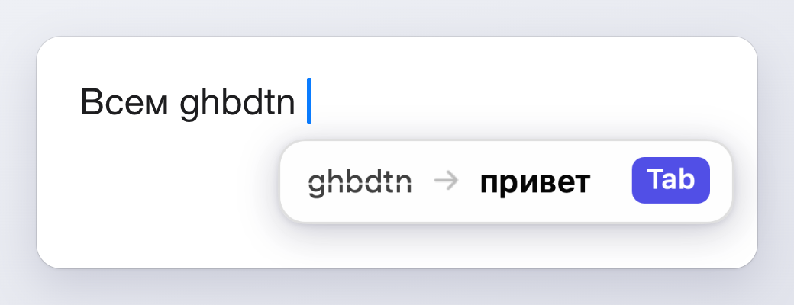

<div align="center">



# Tilqos

**Исправляет текст, набранный не в той раскладке, и сам переключает раскладку.**<br>
Английский, русский и казахский. Нативное приложение для macOS в меню-баре: `ghbdtn` становится `привет`, `с2леметс3з` — `сәлеметсіз`.<br>
Всё работает на вашем Mac: без облака, без аккаунта, без сети, без телеметрии.

[](https://github.com/elapen/tilqos/releases/latest)
[](LICENSE)
[](#установка)
[](README.md)
[](README.kk.md)



</div>

*Tilqos* (казахское «Тіл қос» — «включи язык») — независимый проект с открытым кодом. Он похож по назначению на Punto Switcher и **никак не связан с Яндексом и не одобрен им**.

## Зачем это нужно

Вы начали фразу, подняли глаза — а на экране `ghbdtn rfr ltkf` вместо `привет как дела`. Tilqos замечает это, переписывает слова, переключает раскладку, и вы печатаете дальше.

Для тех, кто каждый день печатает на нескольких из **английского, русского и казахского** на Mac: двуязычных и трёхъязычных авторов, студентов, разработчиков — в Казахстане и не только.

**Казахский здесь — полноценный язык, а не приложение сбоку.** В macOS русская и казахская раскладки **совпадают на всех 33 русских буквах** и различаются только цифровым рядом (и парой клавиш по краям): там, где у казахской раскладки девять её собственных букв, у русской — цифры:

| Клавиша | ABC | Русская | Казахская |
|---|---|---|---|
| `2` | `2` | `2` | **ә** |
| `3` | `3` | `3` | **і** |
| `4` | `4` | `4` | **ң** |
| `5` | `5` | `5` | **ғ** |
| `=` | `=` | `=` | **һ** |
| `9` | `9` | `9` | **ұ** |
| `-` | `-` | `-` | **ө** |
| `8` | `8` | `8` | **ү** |
| `0` | `0` | `0` | **қ** |

(Это проверяют тесты на настоящих раскладках macOS; полная таблица — в [docs/KAZAKH.md](docs/KAZAKH.md).) Из этого следует три вещи, на которых построено всё приложение:

1. **Латиница ↔ кириллица** портит слово целиком: `привет` ↔ `ghbdtn`. Распознаётся легко.
2. **Казахский на русской раскладке** портит только девять казахских букв, и они становятся цифрами (семь из девяти; ещё две — знаками `=` и `-`): `сәлеметсіз` → `с2леметс3з`, `қазақ` → `0аза0`. Цифра внутри кириллического слова — очень сильный сигнал.
3. **Русский текст на казахской раскладке выглядит правильно** (`Астана` остаётся `Астана`). Исправлять нечего, переключать тоже. Это убирает главный источник ложных срабатываний.

В казахской раскладке цифры лежат на Option, поэтому Tilqos хранит **нажатия клавиш, а не символы**: таблица «символ → символ» такой случай без потерь выразить не может.

<div align="center">

</div>

<sub>Анимация — иллюстрация сценария, а не запись экрана, и она показывает **режим подсказок** (по умолчанию для терминалов и для слов, в которых программа не уверена). В режиме «Авто» слово, в котором детектор уверен (выше порога пресета), заменяется сразу при вводе пробела, без карточки.</sub>

## Что умеет

- **Исправляет сам или предлагает.** Когда детектор уверен, слово заменяется, как только вы поставили пробел или знак препинания; когда нет — у курсора появляется маленькая карточка (`было → стало`), и **Tab** принимает замену. Любая другая клавиша закрывает её, слово остаётся как набрано.
- **Переключает раскладку** после исправления, чтобы следующее слово вышло правильно. Если в исправленном слове нет ни одной из девяти казахских букв, русский и казахский выглядят одинаково; тогда Tilqos смотрит на вашу настройку или на кириллическую раскладку, которой вы пользовались в этом приложении в последний раз.
- **Настоящие слова не трогает никогда.** `еще`, `тот`, `her` остаются. URL, пути, e-mail, `snake_case` и `camelCase`, вызовы вроде `foo(`, аббревиатуры капсом и слова после `$ # @ \` не меняются вообще.
- **Значок в меню-баре** показывает текущую раскладку клавишей (`EN`, `РУ`, `ҚАЗ`), бледнеет, когда приложение выключено, и сменяется предупреждающим треугольником, если не хватает разрешения. В меню словами написано, работает ли оно; там же переключатель, «Не исправлять в *этом приложении*» и отмена последнего исправления в один клик.
- **Правила для каждого приложения.** Автоисправление, только подсказки или выключено (Настройки → Приложения). Менеджеры паролей и окно входа выключены всегда; в терминалах по умолчанию только подсказки, а принимать их нужно `⌥Space`, потому что Tab нужен самому терминалу.
- **Пресеты «Осторожно», «Сбалансировано», «Смело»** (пороги автоисправления/подсказки 0.93/0.55, 0.80/0.45, 0.55/0.30); оба порога и минимальную длину слова можно настроить вручную.
- **Отмена** — `⌥⇧Z`; отмена сразу после замены учит приложение не трогать это слово.
- **Обучение** на ваших действиях: отменённые замены, стёртые и набранные заново слова, принятые и отклонённые подсказки, слова, которые вы оставляете и которых нет в словарях. Хранится в виде хешей, отключается, забывается по слову или целиком.
- **Транслитерация казахского** латиница ⇄ кириллица (`⌥⇧T`): официальный алфавит 2021 или практическая ASCII-запись, как пишут в чатах (`qalaisyz` → `қалайсыз`); разбор с учётом сингармонизма и казахской морфологии, в том числе в смешанном казахско-русском тексте.
- **Исправить выделение / конвертировать буфер обмена** — для текста, который вы не набирали на этой клавиатуре.
- **Интерфейс на английском, русском и казахском**: он следует языку системы, а язык можно выбрать в Настройки → Основные. Автозапуск при входе в систему — по желанию, по умолчанию выключен.

| Клавиши | Действие |
|---|---|
| `⌥⇧F` | исправить последнее слово (даже настоящее: вы попросили) |
| `⌥⇧S` | исправить выделение |
| `⌥⇧Z` | отменить последнее исправление |
| `⌥⇧V` | конвертировать буфер обмена |
| `⌥⇧T` | транслитерация латиница ⇄ кириллица |
| `⌥⇧1` / `⌥⇧2` / `⌥⇧3` | English / Русский / Қазақша |
| `⌥⇧L` | включить / выключить Tilqos (работает и когда он выключен) |
| `Tab` | принять подсказку (в терминалах и редакторах кода — `⌥Space`) |

Любое сочетание переназначается в Настройки → Горячие клавиши.

## Скриншоты

| | |
|---|---|
|  |  |
| **Окно приветствия** ведёт через выдачу разрешения, затем пятишаговое обучение даёт попрактиковаться на настоящем движке | **Настройки** в духе «Системных настроек»: пресеты словами, пороги — если нужны |
|  | |
| **Карточка подсказки** появляется у курсора и не забирает фокус | |

## Установка

| Платформа | Где взять | Примечания |
|---|---|---|
| **macOS 14+**, Apple silicon | [`Tilqos-1.0.0-macOS-arm64.dmg`](https://github.com/elapen/tilqos/releases/latest) | Перетащите в «Программы». Без нотаризации: см. «Первый запуск». |
| macOS через Homebrew | `brew install --cask elapen/tap/tilqos` | То же приложение; те же замечания про первый запуск. |
| Из исходников | `git clone https://github.com/elapen/tilqos && cd tilqos && ./build.sh install` | Нужен Swift 6.0+ (Xcode 16+). Ставит в `/Applications`. На Mac с Intel не проверялось. |
| **Windows 10/11**, *экспериментально* | [`Tilqos-1.0.0-Windows-x64.zip` или `-arm64.zip`](https://github.com/elapen/tilqos/releases/latest) | **Автор ни разу не запускал на настоящей Windows.** Без подписи. См. [Windows](#windows-экспериментально). |

В описании релиза указаны SHA-256 каждого файла. Автообновления в Tilqos **нет**: следите за [страницей релизов](https://github.com/elapen/tilqos/releases).

*Совместимость:* macOS 14 — заявленный минимум (`Info.plist`, `Package.swift`), но разрабатывалось и проверялось только на macOS 27; macOS 14–26 не проверялись.

### Первый запуск (Gatekeeper)

Сборки **подписаны ad-hoc и не нотаризованы**, поэтому macOS блокирует первый запуск:

1. Откройте DMG, перетащите **Tilqos** в **«Программы»** и запустите.
2. Когда macOS откажет: на **macOS 14** — правый клик по приложению → **Открыть** → **Открыть**. На **macOS 15 и новее** этого пути больше нет: откройте **Системные настройки → Конфиденциальность и безопасность**, прокрутите до сообщения про Tilqos и нажмите **«Всё равно открыть»**.
3. Если вам удобнее Терминал и вы доверяете загрузке: `xattr -dr com.apple.quarantine /Applications/Tilqos.app`.

### Разрешения

macOS требует выдавать приложению, которое следит за клавиатурой, доступ вручную.

- **Универсальный доступ (Accessibility)** — вот его и нужно выдать (Системные настройки → Конфиденциальность и безопасность → Универсальный доступ → включите **Tilqos**; окно приветствия открывает этот раздел само). Он нужен, чтобы видеть нажатия, «проглатывать» клавишу принятия подсказки (чтобы Tab не напечатался), читать текст перед кареткой и заменять неверный текст.
- **Мониторинг ввода (Input Monitoring)** — необязательный запасной вариант: он позволяет только *читать* нажатия, то есть замечать ошибки и предлагать подсказки, но не применять их. Если Универсальный доступ выдан, Tilqos может вообще не появиться в списке мониторинга ввода — это нормально.
- Больше ничего не запрашивается: ни записи экрана, ни полного доступа к диску, ни сети.

> **После обновления выдайте разрешение заново.** macOS привязывает разрешение к идентичности кода приложения, а подпись ad-hoc у каждой сборки своя. После установки новой версии старая строка в списке может выглядеть включённой, но уже не действовать. Закройте Tilqos, удалите строку **Tilqos** в разделе Универсальный доступ (**−**) или выполните `tccutil reset Accessibility io.github.elapen.tilqos`, откройте Tilqos и выдайте доступ ещё раз. Подробности и что делать, если ничего не происходит, — в [docs/PERMISSIONS.md](docs/PERMISSIONS.md).

Запускайте Tilqos из Finder, Dock или командой `open -a Tilqos`, а не из шелла: macOS приписывает запрос разрешения тому процессу, который запустил приложение.

Нужны хотя бы две из раскладок **ABC (или US), «Русская» и «Казахская»** в Системные настройки → Клавиатура → Источники ввода; Tilqos переключает только между теми, что у вас есть.

## Как принимается решение

Решение опирается на доказательства, от сильного к слабому (все подробности и числа — в [docs/HOW_IT_WORKS.md](docs/HOW_IT_WORKS.md)):

1. **Набранное — настоящее слово?** Тогда оно никогда не меняется автоматически.
2. **Другое прочтение — настоящее слово?** Искажение раскладкой не слово ни в одном языке (`ghbdtn`), а его перевод — слово (`привет`). У брендов и терминов наоборот. На этой асимметрии и держится безопасность исправлений. «Настоящее слово» — это словоформы из hunspell-словарей (основы и правила аффиксов, а не только заглавные слова), ваш собственный словарь и список брендов.
3. **Частотность — для коротких слов.** Трёхбуквенное исправление принимается, только если получается одно из самых частых слов языка: `ult` → `где` да, `afk` → `фал` нет.
4. **Контекст.** Письменность соседних слов и текста перед кареткой склоняет решение, но не решает его.
5. **Структура.** Цифра или дефис внутри кириллического слова (`с2лем`) — это казахский на русской раскладке, что бы ни говорили словари. Морфология казахского (`десеңіздер` = `десе` + `ңіз` + `дер`) её подкрепляет.
6. **Символьные триграммные модели — последними**, для слов, которых нет ни в одном словаре, и только как подсказка, никогда автоматически.

Слово заканчивается только клавишей, которая не буква **ни в одной** из ваших раскладок, поэтому `,skj` (`было`) и `[jhjij` (`хорошо`) не режутся пополам.

## Точность

На собственном регрессионном корпусе проекта (`swift test --filter CorpusTests`), настройки по умолчанию:

| | |
|---|---|
| Правильно набранные слова изменены | **0 из 1 858** |
| Правильно набранные предложения изменены | **0 из 132** |
| Слова в неверной раскладке исправлены автоматически | **240 из 249 (96,4 %)**; ещё 6 предложены подсказкой |
| Предложения в неверной раскладке, преобразованные полностью и верно | **152 из 152** |
| Смешанный текст и контекстные случаи | **34 из 34** |

**Прочтите это, прежде чем верить цифрам.** Корпус написан автором, а константы решения подбирались по нему же, поэтому это результаты *на обучающей выборке*, а не независимый тест. Казахская часть мала (например, по 20 казахских предложений на направление). Корпус — повседневная лексика; жаргон, код, имена и сильно смешанные чаты дадут результат хуже. Симуляция гоняет настоящий детектор на настоящих раскладках macOS, но не настоящие приложения. Воспроизводятся они командами из [docs/ACCURACY.md](docs/ACCURACY.md); о других продуктах ничего не утверждается, а цифр про CPU и память нет, потому что в репозитории нечем их мерить.

## Приватность

Чтобы заметить неверную раскладку, Tilqos следит за каждой нажатой клавишей, поэтому ниже написано в точности, что он с ними делает. Подробности и границы обещаний — в [docs/PRIVACY.md](docs/PRIVACY.md).

- **Буфер набранного слова живёт только в памяти.** Он очищается после 5 секунд без набора (по таймеру), при смене приложения, на Return, Tab, Escape и подобных границах, в полях пароля, при блокировке экрана и сне.
- **Отмена хранит только последние исправления**, в памяти, не дольше 2 минут; они стираются при блокировке или сне, выходе и смене приложения.
- **Буфер обмена затрагивается только действиями, которым он нужен** (исправить выделение, транслитерация, конвертировать буфер). Прежнее содержимое возвращается. Содержимое, помеченное как скрытое или временное (менеджеры паролей), не читается никогда. Текст длиннее 10 000 символов игнорируется.
- **Набранный текст, содержимое буфера и заголовки окон не пишутся в журнал никогда.**
- **Локально хранится:** настройки, исключения для приложений, добавленные вами слова-исключения (обычным текстом) и выученный словарь в виде **солёных 64-битных хешей FNV-1a**. Эти хеши *не* являются криптографически необратимыми: тот, кто может прочитать файл, способен угадать короткие частые слова. В настройках есть «Очистить слова-исключения» и «Сбросить выученные слова».
- **Нет сети, нет телеметрии, нет автообновления.**
- **Пока включён защищённый ввод (secure input), ничего не читается и не пишется в журнал** (поля пароля в macOS и всё, что включает Secure Event Input). Поля, которые его не включают, этим механизмом не защищены.

Границы: другое ПО с тем же разрешением видит всё то же, что и Tilqos; система может писать дампы памяти при сбое; сборки не нотаризованы — сверяйте контрольные суммы или собирайте из исходников. Ошибки приватности — это ошибки безопасности: см. [SECURITY.md](SECURITY.md).

## Windows (экспериментально)

В `windows/` лежит порт того же движка на Go (только стандартная библиотека, x64 и ARM64). Живёт в области уведомлений, горячие клавиши — `Pause`, `Shift+Pause`, `Alt+Pause`, `Alt+Scroll Lock` (Alt+Shift в Windows — это переключение раскладки), подсказки принимаются Tab или Insert, а текст в стандартных полях Edit/RichEdit проверяется перед заменой.

**Статус: экспериментально.** Порт собран и проверен на Mac (кросс-компиляция); на всех эталонных данных он принимает те же решения, что и Swift-движок, но код перехвата клавиатуры, `SendInput`, буфера обмена, трея и всплывающей подсказки **автор ни разу не запускал на настоящей Windows**. Исполняемый файл не подписан (SmartScreen предупредит). Поля паролей в браузерах там не распознаются. Пожалуйста, проверьте и расскажите, что получилось: в [windows/README.md](windows/README.md) — сборка, отличия от macOS, ограничения и ручной чек-лист.

```bash
cd windows && ./build.sh        # нужен Go 1.25+; macOS или Linux (кросс-сборка); на Windows: .\build.ps1
```

## FAQ

**Это кейлоггер?** Чтобы работать, программа читает каждую клавишу — поэтому и существуют этот текст, [docs/PRIVACY.md](docs/PRIVACY.md) и исходники. Буфер набранного живёт только в памяти, текст не пишется в журнал, сетевого кода нет.
**После обновления перестало работать.** Выдайте разрешение Универсального доступа заново (см. выше).
**Исправило слово, которое я набрал правильно.** Сразу нажмите `⌥⇧Z`: слово попадёт в исключения и больше так не будет. Если повторяется — выберите пресет «Осторожно» и заведите issue.
**Ничего не происходит.** Загляните в [docs/PERMISSIONS.md](docs/PERMISSIONS.md#when-nothing-seems-to-happen): разрешение для *этой* сборки, хотя бы две раскладки, режим приложения, поле пароля в фокусе.
**Почему нет нотаризации?** Для неё нужен сертификат Apple Developer ID; скрипты сборки её поддерживают, но не проверялись. Помощь приветствуется.
**Будут другие языки?** Возможно: см. [CONTRIBUTING.md](CONTRIBUTING.md#adding-a-language) и форму «Language request».
Ещё — в [docs/FAQ.md](docs/FAQ.md).

## Документация

[Как принимается решение](docs/HOW_IT_WORKS.md) · [Точность](docs/ACCURACY.md) · [Казахский](docs/KAZAKH.md) · [Приватность](docs/PRIVACY.md) · [Разрешения](docs/PERMISSIONS.md) · [Сборка](docs/BUILDING.md) · [Устройство](docs/ARCHITECTURE.md) · [FAQ](docs/FAQ.md) · [Список изменений](CHANGELOG.md)

Подробная документация написана по-английски; этот README и [README.kk.md](README.kk.md) — её краткое изложение на русском и казахском.

## Участие

Отчёты об ошибках, проверка на Windows, вычитка русских и казахских текстов, корпуса для оценки точности, помощь с нотаризацией и новые языки — всё это приветствуется: [CONTRIBUTING.md](CONTRIBUTING.md). Идеи и вопросы — в [Discussions](https://github.com/elapen/tilqos/discussions).

## Благодарности и лицензии

Код Tilqos — [MIT](LICENSE). Языковые данные в `Resources/Models/` — **сгенерированные, с потерями, производные от сторонних словарей, и лицензии у них остаются прежними**: казахский hunspell-словарь (MPL 1.1 / LGPL 2.1+ / GPL 2.0+; Алексей Липчанский, Акмарал Мусаева, László Németh, Раиль Алиев и другие), русский словарь LibreOffice (Alexander I. Lebedev, BSD-подобная лицензия), американский английский словарь LibreOffice на основе SCOWL (Kevin Atkinson) и Ispell (Geoff Kuenning) и статистика букв из `/usr/share/dict/words`. Полные благодарности, описание изменений, где лежит исходный код и лицензия Go для сборки под Windows — в [THIRD_PARTY_NOTICES.md](THIRD_PARTY_NOTICES.md); дословные тексты лицензий — в [`LICENSES/`](LICENSES). Приложение для macOS подключает только системные фреймворки Apple.
